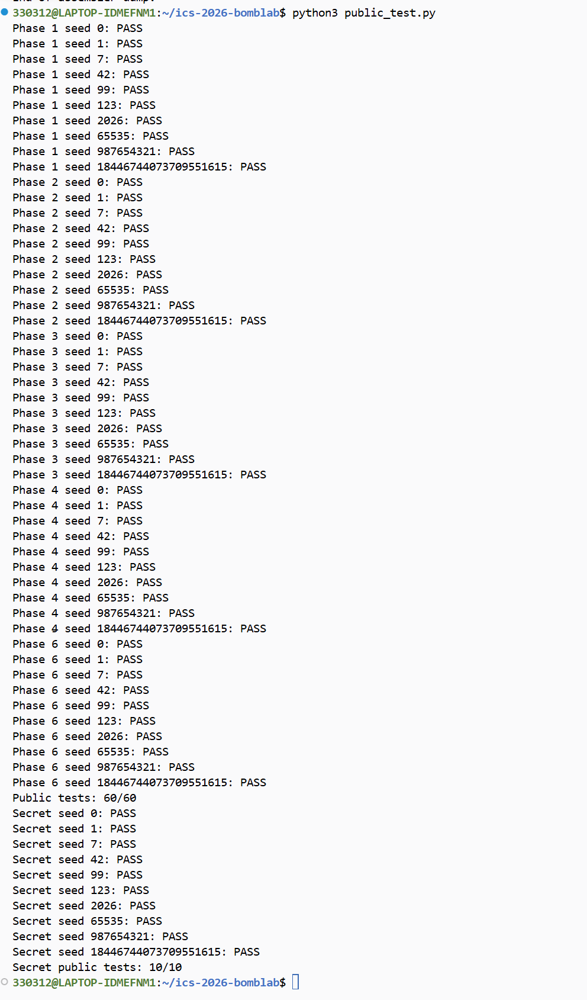
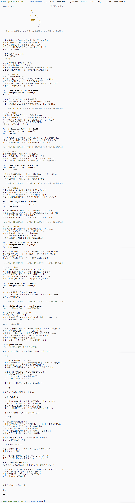

# Lab2：Bomb Lab 实验报告

## 1. 实验结果

前六关公开测试通过 60/60，Honor 通过 10/10。



我另外使用公开列表之外的 seed `330312` 运行完整流程，前六关和 Honor 均通过。



## 2. 各关分析

记 `C` 为 challenge。

### 2.1 第一关：函数传参

`valid_u32_fields` 调用前将 `esi` 设为 1，说明输入是一个整数。关卡将 challenge 传入 `p1_compute`，再用 `cmp %eax,-0x14(%rbp)` 比较返回值和输入。

```asm
mov %r12,%rdi
call p1_compute
cmp %eax,-0x14(%rbp)
sete %al
```

根据每次调用前 `edi`、`esi` 中的值追踪参数，得到实际调用顺序为 `step1 → step0 → step2`，计算关系为：

```text
L=u32(C)，H=u32(C>>32)，M=u32(C>>16)
t1=(M^0x63e7)+8*H
t0=(3*L)^(H+0x31ca)
答案=(t0+8*t1)^0x1f14
```

这一关让我熟悉了参数传递和返回值的使用，也理解了写入 `edi` 时 `rdi` 高 32 位清零的效果。

### 2.2 第二关：数组和递推

格式检查要求 6 个整数。`sscanf` 将第一个数写入 `rbp-0x40`，后面的数每隔 4 字节排列，因此可以记为数组 `a[0]`～`a[5]`。

循环中的关键指令是：

```asm
shr %cl,%rax
and $0x3f,%eax
add %edx,%eax
xor %esi,%eax
mov -0x40(%rbp,%rdx,4),%esi
lea (%rax,%rax,4),%eax
cmp %eax,%esi
```

`rdx` 是下标，从 1 到 5；`ecx` 从 20 开始，每轮加 3。计算时 `esi` 还是上一项，随后才加载当前项用于比较。`lea` 将计算结果乘 5。

```text
a[0]=((C>>42)&0xf)^0x10
shift=20+3*(i-1)
a[i]=((((C>>shift)&0x3f)+i)^a[i-1])*5，i=1～5
```

### 2.3 第三关：跳转表

输入是两个整数。第一个数与 `C&7` 比较，第二个数与 `p3_dispatch` 的返回值比较。

```asm
cmp $7,%eax
ja  失败分支
notrack jmp *0x405820(,%rax,8)
```

我读取跳转表中的地址，并与各分支的指令地址对应，确定索引和实际函数之间的关系。索引为 `index=C&7`，传入分支的参数为 `x=u32(C>>32)^u32(C>>3)`。

我将分支关系整理成 switch，依次输出 index 和对应的计算结果。

### 2.4 第四关：递归

输入是一个整数。调用 `p4_walk` 时，四个参数分别是：

```text
target=C&0x7f
low=0，high=127
key=u32(C>>7)^u32(C>>32)
```

函数先计算 `mid=low+((high-low)>>1)`。`cmp` 后的 `je` 对应命中中点，`jb` 对应目标小于中点。向左递归的参数准备是：

```asm
lea -1(%rdi),%edx
mov %eax,%edi
call p4_walk
```

此时 `edi` 原先是 mid，`eax` 保存 target，所以新上界是 `mid-1`，目标不变。向右则将下界改为 `mid+1`。

命中中点时返回 `(mid+0xe3)^key`。未命中时，当前层先保存 `mid+key`，子调用返回后将返回值乘 3，再与当前层保存的值异或；向左最后异或 3，向右最后异或 `0xc`。最终输出最外层的返回值。

### 2.5 第五关：指针和链表

输入是两个整数。起点由 `C&7` 选择，表中存放的是节点地址。

```asm
mov 0x405b60(,%rax,8),%rdx
mov 0x8(%rdx),%esi
add 0xc(%rdx),%eax
mov (%rdx),%rdx
```

节点偏移 0 处是 8 字节的 next 指针，偏移 8、12 处是两个 32 位整数，记为 `field8`、`field12`。最后一条将节点开头存放的地址读回 `rdx`，相当于 `p=p->next`。

根据这些偏移恢复节点结构，并读取节点中的 next 和两个整数字段。实现时将节点地址转换成数组下标，按 next 保存的关系连接节点。

```text
acc=u32(C>>6)^u32(C>>32)^0x141d
额外移动次数 n=(C>>3)&3
每处理一个节点：acc=(3*acc+field12)^field8
```

先处理起始节点，再沿 next 移动 n 次，所以共处理 `n+1` 个节点。第一个答案是最终 acc，第二个答案是最后访问节点的 `field8`。

### 2.6 第六关：函数指针表

输入是一个整数。通过函数表连续调用两次，并将第一次结果加工后传给第二个函数。

```asm
call *0x405e00(,%rax,8)
xor $0x1527,%eax
mov %eax,%edi
call *0x405e00(%rbx)
add $0x7b22,%eax
```

我读取函数指针表后，将各表项对应到具体的辅助函数。第一次调用的下标为 `C&7`，第二次使用 `rbx=C&0x38` 作为字节偏移，对应下标为 `(C>>3)&7`。

设表中函数为 `F[i]`，输入初值 `x=u32(C>>6)^u32(C>>32)`，最终结果为：

```text
t=F[C&7](x)
答案=F[(C>>3)&7](t^0x1527)+0x7b22
```


### 2.7 Honor：字符串复制和栈内存布局

`secret_copy` 逐字节复制输入，直到复制完字符串结束的零字节。`secret_gate` 中的关键位置是：

```asm
lea -0xd0(%rbp),%r12
call secret_copy
cmpl $0x4e45504f,-0xb0(%rbp)
jne 失败分支
lea -0xac(%rbp),%rdi
call secret_phase
```

复制起点是 `rbp-0xd0`，被检查位置距起点 32 字节。按小端序，`0x4e45504f`，即 `OPEN`。传给 `secret_phase` 的字符串从偏移 36 开始，它要求三个无符号整数。因此输出布局为：32 个填充字符、`OPEN`、三个整数的文本。

长度检查使用 `strlen` 后减 36，再进行无符号比较，允许总长度为 36～163。实现使用 32 个 `A` 填充，并用 `snprintf` 写入及检查截断。

从 main 的调用处确认，传入的第二、第三个参数分别为 challenge 和 context。记 `T=context`，计算关系为：

```text
A=u32(C>>32)^u32(C)
B=u32(T>>32)^u32(T)
k=T&3
x=A^B
mix(x)=((x>>5)^0x3adc)+(x^0x4f64)
a[0]=k
a[1]=mix(x)^((k*0x4f64)^u32(T>>16))
a[2]=a[1]^(0x3adc+B+k+(A>>5))
```


## 3. 实验总结

开始实验时我没有 GDB 和汇编基础，先跟着 tutor 练习了断点、查看参数和单步执行。分析中最容易混淆的是寄存器改写后的含义，以及内存地址和内存内容。例如 `lea` 只算地址，`mov (%rdx),%rdx` 则会读取旧地址中的内容并覆盖寄存器；同一个 `edi` 在函数入口可能是目标值，计算中点后又变成 mid。

我也曾把 `jne` 的条件翻反，把额外移动次数当成总节点数等，在此过程中有请教 ai。逐条记录寄存器当前值、区分循环外和循环内的操作后，这些地方才比较清楚。这次实验让我把 C 中的函数调用、数组、递归和链表与实际指令联系起来，也逐渐习惯了从输入检查和返回值比较入手分析程序。

